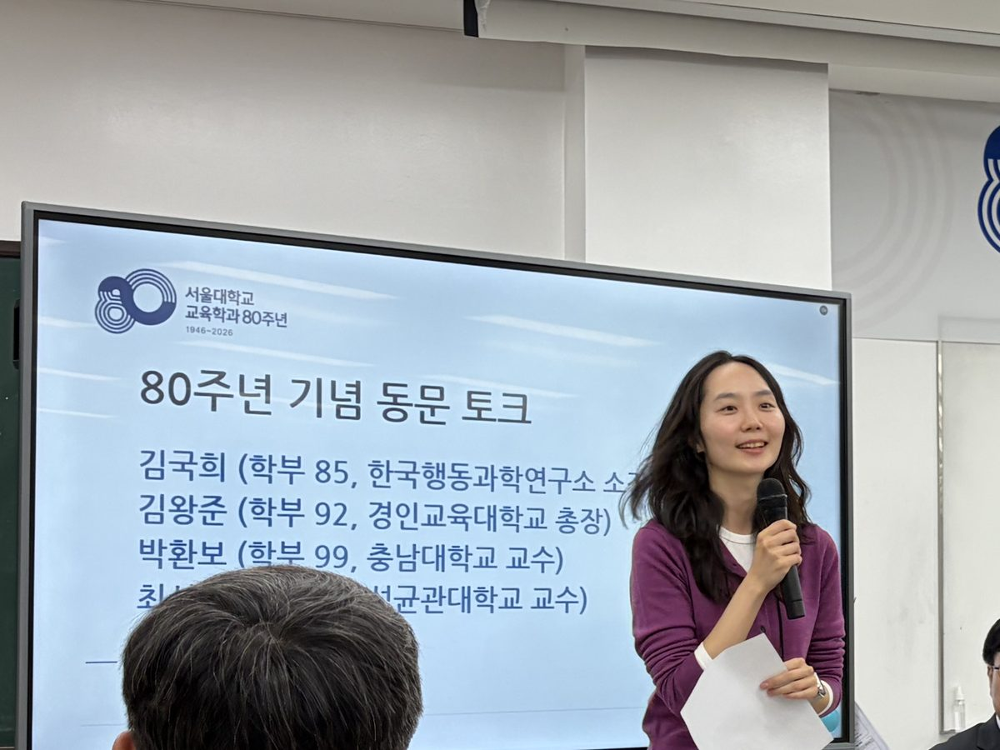

::: {.hero}
[Literacy and Learner Diversity Lab]{.hero-title}

[Department of Child Psychology and Education, Sungkyunkwan University]{.hero-sub}

:::

::: {.intro}
How can we do a better job of helping every child get the educational support they need to reach their full potential? We approach this question especially through literacy, which is central to lifelong learning and linked to a range of individual and social outcomes beyond school and academics, such as employment, health, civic participation, and social-emotional well-being. Literacy development may seem simple, but it is a complex process in which cognitive, metacognitive, and linguistic skills and knowledge come together over time, and some children struggle persistently. It is also intertwined with children's experiences, environments, resources, and the support they receive.

Through rigorous scientific research, we seek to understand which specific skills warrant more attention in educational practice, when and how to support them, who struggles, and why. Building on this understanding, we work to address children's needs through prevention, early identification, instruction and intervention, and data-based decision making, and to build systems that can sustain this support. We pay particular attention to children whose needs have not been well met, such as multilingual learners, children with learning-related disabilities, and children from lower socioeconomic backgrounds, while trying to see each child beyond such socially constructed categories.

:::

::: {.join-banner}
We welcome new members, from undergraduate research assistants to graduate students.

[Current openings →](join.qmd){.btn-warm}
:::

::: {.intro}
[Research keywords]{.keywords-label}

[Literacy development]{.chip} [Comprehension]{.chip} [Learner diversity]{.chip} [Individual differences]{.chip} [Learning disabilities]{.chip} [Multilingual learners]{.chip} [Assessment]{.chip} [Tiered systems of support]{.chip} [Data-based individualization]{.chip} [Digital media & AI]{.chip}
:::

## News

::: {.news-grid}

::: {.news-card}
{fig-alt="WELCOME spelled with letter tiles"}

[Member]{.news-tag} [2026.11]{.post-date}

Ina Jeong will join us in January 2027 as our first graduate student. Welcome, Ina!
:::

::: {.news-card}
{fig-alt="Alumni talk panel at the SNU Department of Education 80th anniversary"}

[Talk]{.news-tag} [2026.10]{.post-date}

Dr. Choi joined an alumni panel at the 80th anniversary of the Department of Education, Seoul National University. Great to be back!
:::

::: {.news-card}
{fig-alt="START painted on pavement"}

[Lab]{.news-tag} [2026.09]{.post-date}

The Literacy and Learner Diversity Lab opened in the Department of Child Psychology and Education at Sungkyunkwan University. Here we go!
:::

:::
