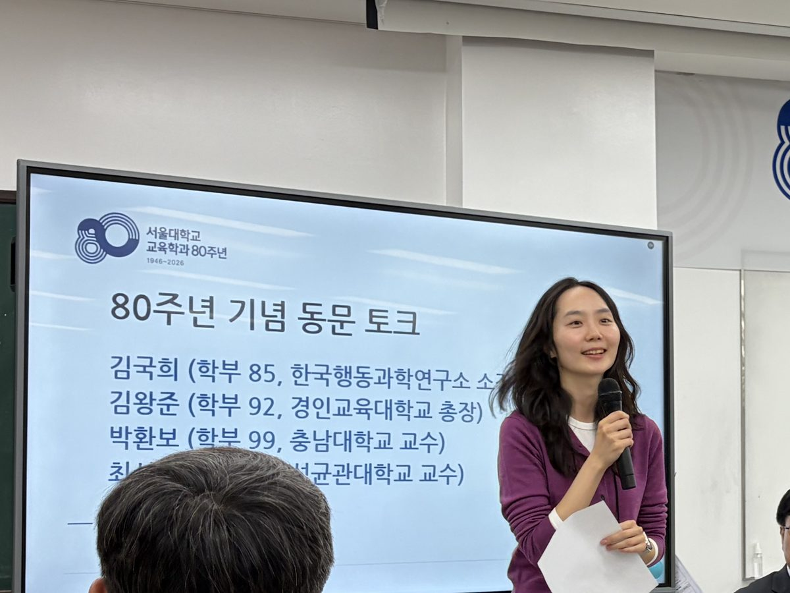

::: {.hero}
[문해 및 학습자 다양성 연구실]{.hero-title}

[성균관대학교 아동청소년학과]{.hero-sub}

:::

::: {.intro}
모든 아이가 필요한 교육적 지원을 받아 잠재력을 충분히 펼칠 수 있도록 우리는 어떤 노력을 할 수 있을까요? 우리 연구실은 특히 문해를 중심으로 이 질문의 답을 찾아갑니다. 문해는 평생 학습의 기초이며, 학교와 학업을 넘어 고용, 건강, 사회 참여, 사회정서적 웰빙 등 여러 개인적·사회적 결과와도 연결됩니다. 문해 발달은 단순해 보이지만 인지·메타인지·언어 능력과 지식이 오랜 시간 함께 발달하는 복잡한 과정이어서, 어떤 아이들은 지속적인 어려움을 겪습니다. 또한 아이의 경험과 환경, 자원, 받아 온 지원과도 깊이 얽혀 있습니다.

우리는 교육 현장에서 어떤 세부 기술에 언제, 어떻게 더 주목해야 하는지, 그리고 누가, 왜 어려움을 겪는지를 엄밀한 연구를 통해 이해하고자 합니다. 이를 바탕으로 예방과 조기 판별, 교수와 중재, 데이터 기반 의사결정을 통해 아이들의 요구에 대응하고, 이러한 지원이 지속될 수 있는 체계를 만들고자 합니다. 특히 다언어 아동, 학습 관련 장애가 있는 아동, 사회경제적으로 어려운 환경의 아동처럼 그동안 충분한 지원을 받지 못해 온 아이들에게 주목하되, 동시에 사회적으로 나뉜 범주에 갇히지 않고 각 아이의 요구를 살피고자 합니다.

:::

::: {.join-banner}
학부 연구보조원과 대학원생을 모집합니다.

[모집 안내 보기 →](join.qmd){.btn-warm}
:::

::: {.intro}
[연구 키워드]{.keywords-label}

[문해 발달]{.chip} [이해 (comprehension)]{.chip} [학습자 다양성]{.chip} [개인차]{.chip} [학습장애]{.chip} [다언어 아동]{.chip} [평가]{.chip} [다층적 지원체계]{.chip} [데이터 기반 개별화]{.chip} [디지털 미디어와 AI]{.chip}
:::

## 소식

::: {.news-grid}

::: {.news-card}
{fig-alt="WELCOME 글자 타일"}

[Member]{.news-tag} [2026.11]{.post-date}

정인아 학생이 2027년 1월부터 연구실의 첫 대학원생으로 함께합니다. 환영합니다 :)
:::

::: {.news-card}
{fig-alt="서울대학교 교육학과 80주년 기념행사 동문 토크"}

[Talk]{.news-tag} [2026.10]{.post-date}

최서현 교수가 서울대학교 교육학과 80주년 기념행사 동문 토크에 패널로 참여했습니다.
:::

::: {.news-card}
{fig-alt="START라고 쓰인 바닥"}

[Lab]{.news-tag} [2026.09]{.post-date}

성균관대학교 아동청소년학과에 문해 및 학습자 다양성 연구실이 문을 열었습니다. 잘 부탁드립니다!
:::

:::
