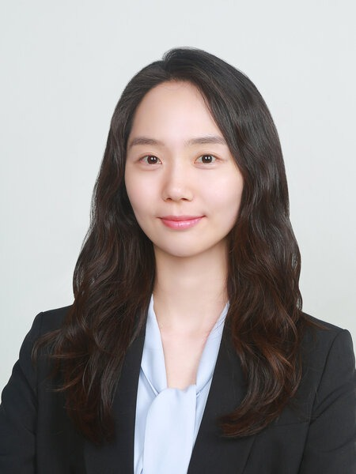
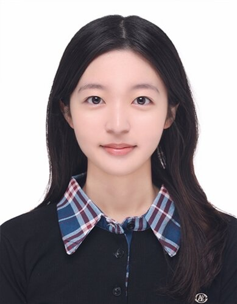

## 연구실 책임자

::: {.person}
{fig-alt="최서현"}

::: {}
**최서현**

[조교수]{.role}

최서현 교수는 성균관대학교 아동청소년학과 조교수입니다. 서울대학교 교육학과에서 학사(2019), 같은 대학 협동과정 특수교육전공에서 김동일 교수의 지도로 석사(2021)를 받았고, 미국 미네소타대학교 교육심리학과에서 Kristen McMaster 교수의 지도로 박사(특수교육, 2025)를 받았으며, Nidhi Kohli 교수의 지도로 교육 양적연구방법론(Quantitative Methods in Education) 부전공을 이수했습니다. 2025–2026년에는 미네소타대학교 교육심리학과에서 Kristen McMaster 교수, Panayiota (Pani) Kendeou 교수와 함께 박사후연구원으로 일했습니다.

아동의 문해 발달과 개인차, 문해 측정·평가 도구의 측정학적 적합성과 공정성, 그리고 집중·개별화 중재와 데이터 기반 의사결정을 포함한 다층적 지원체계를 연구합니다. 연구에서는 종단 자료 분석을 위한 혼합효과모형, 구조방정식모형, 잠재프로파일분석 같은 개인 중심 접근, 문항반응이론(IRT) 기반 모형 등 양적 방법을 주로 활용합니다.

*Learning and Individual Differences*와 *School Psychology* 편집위원, 한국학습장애학회 이사로 활동하고 있으며, *Journal of Educational Psychology*, *Journal of Learning Disabilities*, *Reading and Writing*, *Assessing Writing* 등 여러 학술지의 심사위원으로 꾸준히 참여하고 있습니다.

[CV 다운로드 (PDF)](../files/choiS_CV.pdf){.btn-cv download="choiS_CV.pdf"}
:::
:::

### 학력

- 미네소타대학교 교육심리학 박사 (특수교육; 교육 양적연구방법론 부전공), 2025
- 서울대학교 협동과정 특수교육전공 석사, 2021
- 서울대학교 교육학과 학사, 2019

### 수상

- 2026 · Marjorie Montague Award, 국제학습장애연구학회(IARLD)
- 2026 · 미네소타대학교 우수 학위논문상 Honorable Mention
- 2026 · Walter Kintsch Student Travel Fund, Society for Text & Discourse
- 2024–25 · 미네소타대학교 Doctoral Dissertation Fellowship
- 2024–25 · CEC Division for Research Doctoral Scholar
- 2024 · Taylor & Francis Award, Society for the Scientific Study of Reading
- 2024 · Council for Learning Disabilities Leadership Institute
- 2023–24 · 미네소타대학교 Hauge Graduate Fellowship
- 2021–25 · 풀브라이트 대학원 장학생

## 대학원생

::: {.member}
{fig-alt="정인아"}

::: {}
**정인아**

[석사과정 입학 예정]{.role}

2027년 봄학기에 성균관대학교 아동청소년학과 석사과정에 입학할 예정이며, 2027년 1월부터 연구실에서 함께합니다. 2027년 2월 전북대학교 아동학과를 졸업할 예정입니다.

연구 관심사: 초기 문해 발달, 학습 어려움의 특성 및 평가, 개별화 교육적 지원

이메일 · [inajeong@skku.edu](mailto:inajeong@skku.edu)

:::
:::
