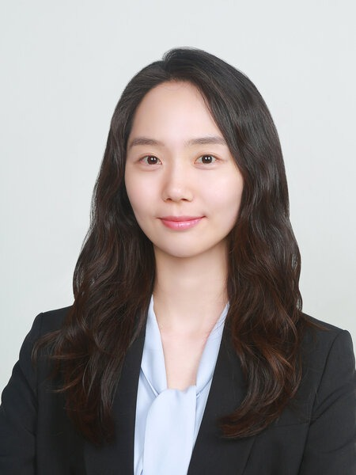
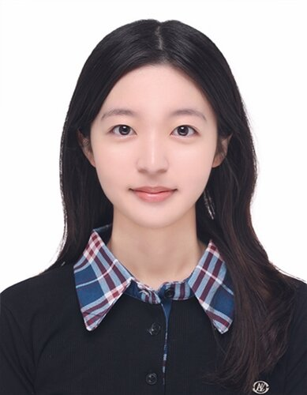

## Lab Director

::: {.person}
{fig-alt="Seohyeon Choi"}

::: {}
**Seohyeon Choi, Ph.D.**

[Assistant Professor]{.role}

Dr. Seohyeon Choi is an Assistant Professor in the Department of Child Psychology and Education at Sungkyunkwan University. She received her B.A. in Education (2019) and M.A. in Special Education (2021; advised by Prof. Dong-il Kim) from Seoul National University in Seoul, South Korea, and her Ph.D. in Educational Psychology (Special Education) from the University of Minnesota in the U.S. (2025; advised by Prof. Kristen McMaster), where she also completed an internal minor in Quantitative Methods in Education with Prof. Nidhi Kohli. From 2025 to 2026, she was a postdoctoral research associate in the Department of Educational Psychology at the University of Minnesota, working with Profs. Kristen McMaster and Panayiota (Pani) Kendeou.

Her research focuses on children's literacy development and individual differences, the psychometric adequacy and fairness of literacy assessments, and tiered systems of support—including intensive, individualized intervention and data-based decision making. Her work draws on quantitative methods such as mixed-effects modeling for longitudinal data, structural equation modeling, person-centered approaches (e.g., latent profile analysis), and item response theory–based modeling.

She serves on the editorial board of *School Psychology* and the executive board of the Korean Learning Disabilities Association. She also regularly serves as an ad hoc reviewer for journals including the *Journal of Educational Psychology*, *Journal of Learning Disabilities*, *Learning and Individual Differences*, *Reading and Writing*, and *Assessing Writing*.

[Download CV (PDF)](files/choiS_CV.pdf){.btn-cv download="choiS_CV.pdf"}
:::
:::

### Education

- Ph.D., Educational Psychology (Special Education; internal minor in Quantitative Methods in Education), University of Minnesota, 2025
- M.A., Special Education, Seoul National University, 2021
- B.A., Education, Seoul National University, 2019

### Awards and Honors

- 2026 · Marjorie Montague Award, International Academy for Research in Learning Disabilities
- 2026 · Distinguished Dissertation Award, Honorable Mention, University of Minnesota
- 2026 · Walter Kintsch Student Travel Fund, Society for Text & Discourse
- 2024–25 · Doctoral Dissertation Fellowship, University of Minnesota
- 2024–25 · Doctoral Scholar, CEC Division for Research
- 2024 · Taylor & Francis Award, Society for the Scientific Study of Reading
- 2024 · Leadership Institute, Council for Learning Disabilities
- 2023–24 · Hauge Graduate Fellowship, University of Minnesota
- 2021–25 · Fulbright Graduate Study Award, U.S. Department of State

## Graduate Students

::: {.member}
{fig-alt="Ina Jeong"}

::: {}
**Ina Jeong**

[Incoming M.A. student]{.role}

Ina will begin working in our lab in January 2027 and join the M.A. program in the Department of Child Psychology and Education at Sungkyunkwan University in Spring 2027. She is expected to receive her B.A. in Child Studies from Jeonbuk National University in February 2027. Her research interests include early literacy development, the characteristics and assessment of learning difficulties, and individualized educational support.

Email · [inajeong@skku.edu](mailto:inajeong@skku.edu)

:::
:::
